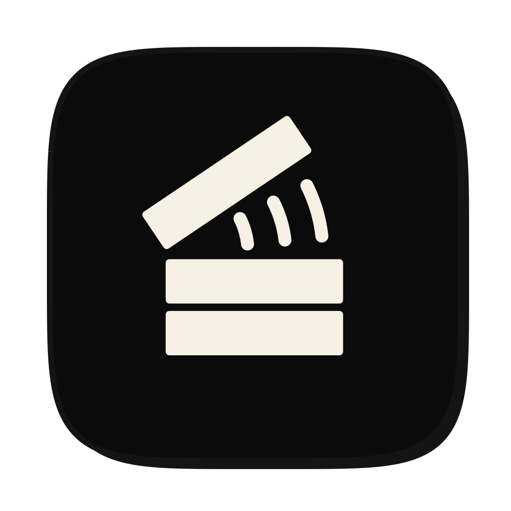

<p align="center"></p>

<h1 align="center">Sound Radar</h1>

<p align="center"><i>Who's making that noise?</i><br>A native macOS app that shows exactly where a sound comes from, and gives every app its own volume fader.</p>

---

You hear a sound. Sound Radar tells you which app is playing it, which window and browser tab, on which screen and which desktop, and takes you there in one click. Then it hands you a fader for that app: 0 to 150 %, mute, or solo.

## What it does

- **Finds every sound.** Lists each app whose audio output is running right now, including helper processes (browser tabs, Electron helpers, the iOS Simulator) mapped back to the app you recognise.
- **Shows where it is.** A live map of your displays with the playing window lit up, its title and browser tab, and whether it sits on another desktop, minimised or hidden.
- **Takes you there.** "Go to" brings that exact window, or browser tab, to the front.
- **Per-app volume.** 0 to 150 % per app with an audio taper, mute and solo, and a live level meter. Survives output device switches.
- **Remembers short sounds.** A history of recent sounds, so an alert chime that played for half a second is still on the list.
- **Menu bar mixer.** A compact mixer in the menu bar with the output volume.

## Requirements

- macOS 26 or later (Liquid Glass interface, Core Audio process taps)
- Xcode 26 command line tools (Swift 6 toolchain)

## Build and run

```bash
git clone https://github.com/fuego-wtf/soundradar.git
cd soundradar
./build.sh --open
```

`build.sh` builds a release binary with SwiftPM, generates the app icon, and assembles an ad-hoc signed `SoundRadar.app` next to the script.

Run the tests with:

```bash
swift test
```

## Permissions

Sound Radar works without any permission: it already shows which apps play sound and on which display. Each permission adds one ability, and the app asks only when you turn it on.

| Ability | macOS permission | What is read |
|---|---|---|
| Per-app volume and live levels | System Audio Recording | Audio levels are measured in memory. Nothing is recorded or saved. |
| Window names on every desktop | Screen Recording | Window titles only. Screen contents are never captured. |
| Jump to the exact window | Accessibility | Raises and un-minimises the chosen window. |
| Browser tabs (Arc, Chrome, Brave, Edge, Safari) | Automation, asked once per browser | The front tab's title and address, and switching to it. |

Nothing leaves your Mac. There is no network code.

## How it works

- **Who is playing:** Core Audio's process objects (`kAudioHardwarePropertyProcessObjectList`, `kAudioProcessPropertyIsRunningOutput`), watched with property listeners so an idle system costs no reads. Helper processes are attributed to their app via the responsible-process call and the parent chain.
- **Where it is:** `CGWindowListCopyWindowInfo` for window bounds, titles and desktop state; Accessibility for raising windows; AppleScript for browser tabs.
- **Volume and levels:** a Core Audio process tap (`CATapDescription`) per playing app, inside a private aggregate device. The app's own output is muted and re-rendered with your gain, on a realtime-safe IO callback (atomics only, no locks or allocation). A watchdog gives the app its own sound back if the re-render ever stalls, and quitting Sound Radar restores every app instantly.

## Known limits

- Browsers do not say which tab is playing, so Sound Radar names the front tab of the playing window. A background tab playing sound cannot be named.
- If macOS answers a denied audio permission with silence instead of an error, Sound Radar cannot tell the difference.
- The level meter shows "needs permission" for about two seconds at launch while the permission check runs.

## Project layout

```
Sources/SoundRadar/
  Audio/      process taps, gain, limiter, meters
  Locate/     window, desktop and browser-tab lookup, jump
  Scan/       background scan engine
  Output/     default output device, master volume
  UI/         SwiftUI interface (Liquid Glass)
  Brand/      the pixel speaker mark and menu bar glyph
Tests/        unit tests for the pure audio math and locator logic
tools/        app icon generator
```

## License

MIT. See [LICENSE](LICENSE).

Made by [Fuego Labs](https://www.fuego.wtf), the lab behind products that make people say WTF.
